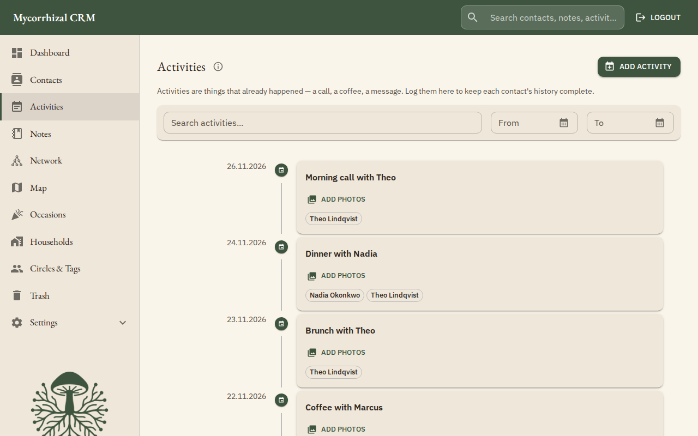
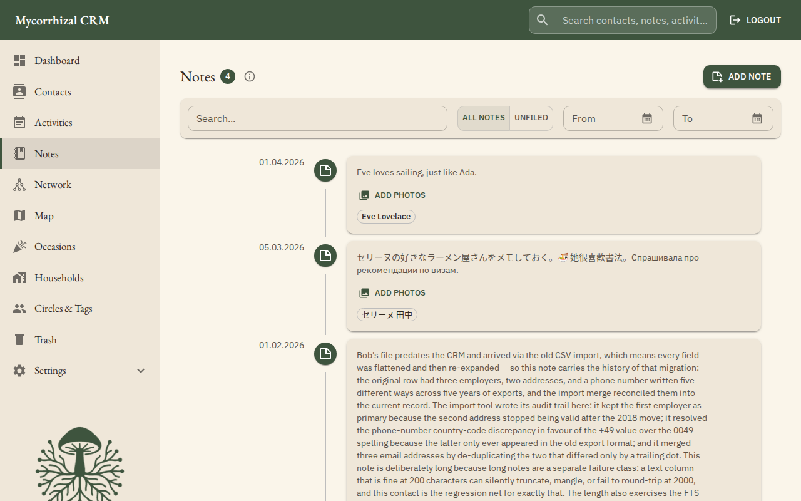

# Activities and notes

An **activity** is something that already happened with someone: a call, a coffee, a message. A **note** is something you want to remember about someone. Both appear on the contact's **Timeline**.

## Log an activity

1. Open **Activities** in the sidebar and choose **Add activity**.
2. Describe what happened, set the date, and choose the contacts who were there.
3. Save.

Use the search box and the **From** and **To** dates to find an activity. Logging an activity also feeds each contact's contact rhythm, so a contact you have just talked to counts as recently contacted.

## Write a note

1. Open **Notes** and choose **Add note**.
2. Write the note and, if you know who it is about, choose the contact.
3. Save.

Quick-jot a note and file it onto a contact when you have a moment. **All notes** shows everything; **Unfiled** shows the notes that still need a contact. Filed notes also appear on the contact's **Timeline**. Use **From** and **To** to narrow by date.

## Add photos

Both activities and notes have **Add photos** for pictures from the occasion.

## Notes, activities and what leaves your server

A note or an activity can be shared on its own with another user on the same server, with the share button on its card. It is a standing share: read-only, live access that they have to accept and that you can revoke at any time. Private and secret items are never shared. See [Privacy](privacy.html) for what leaves your server and what stays on it.
