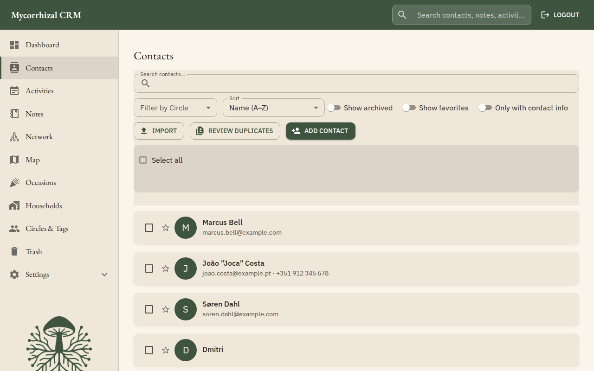
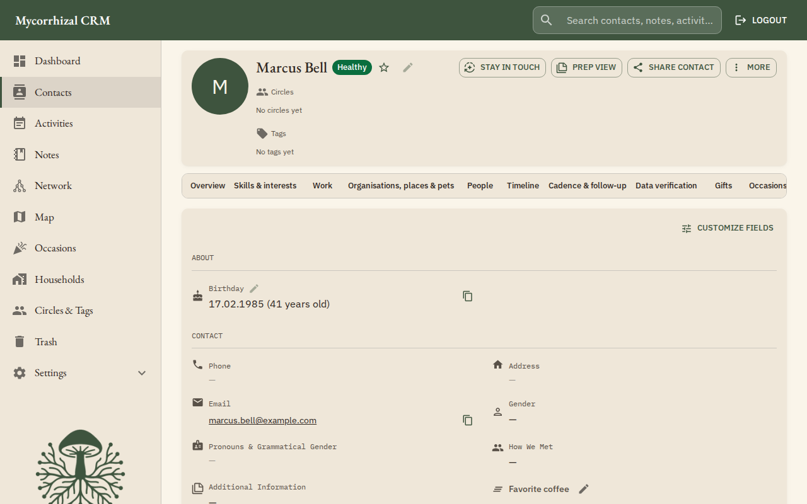

# Contacts

Contacts are the people you keep track of. Everything else (notes, activities, relationships, occasions) hangs off a contact.

## Find a contact

Open **Contacts** in the sidebar. Type in **Search contacts** to narrow the list. You can also:

- pick **Filter by Circle** to show one group of people,
- change **Sort**,
- turn on **Show favorites** to see only starred contacts,
- turn on **Only with contact info** to hide contacts with no email, phone or address,
- turn on **Show archived** to see contacts you have archived.

The search box at the top of every page looks through contacts, notes, activities and places together.

## Add a contact

1. On **Contacts**, choose **Add contact**.
2. Enter at least a first and last name. You can add the rest later.
3. Save.

To bring in many people at once, see [Importing contacts](importing.html).

## A contact's page

Choose a contact in the list to open it.

- The **header** shows the contact's name, a star to mark a favorite, and their circles and tags. The badge next to the name (for example *Healthy*) shows how you are doing against the contact rhythm you set for them; see **Cadence & follow-up** below.
- The buttons at the top right are **Stay in touch**, **Prep view**, **Share contact** and **More**.
- The tabs organise the rest: **Overview**, **Skills & interests**, **Work**, **Organisations, places & pets**, **People**, **Timeline**, **Cadence & follow-up**, **Data verification**, **Gifts** and **Occasions**.
- **Overview** holds the basic details (birthday, phone, email, address and more). Use **Customize fields** to choose which fields appear; fields you hide keep their data. [Settings](settings.html#contact-fields-and-hide-empty-fields) explains the same choice for all contacts.

## Organise contacts

- **Circles** group people (for example "Family" or "Book club"). **Tags** are lighter labels. Manage both under **Circles & Tags**.
- **Households** group the people (and pets) who share a home; see [Relationships](relationships.html#households).
- Select several contacts with the checkboxes in the list to act on them together.
- **Review duplicates** (on the Contacts page) helps you find and merge two records for the same person.

## Share a contact

**Share contact** on a contact's page shares it with another user on the same server, who chooses whether to accept. Pick the **Kind of share**: a **One-time copy** sends a snapshot of the contact as it is now, and a **Standing share** gives read-only, live access you can revoke at any time. Revoking stops future access but cannot take back what was already seen. Private and secret items are never shared. Shares are managed under **Settings**: **Shares** for one-time copies, and **Shared with me** and **Shared by me** for standing shares.

## Delete and restore

A deleted contact goes to **Trash**, where you can **Restore** it. **Delete forever** (or emptying the trash) is permanent, and the Trash page states how long deleted items are kept on your server.
