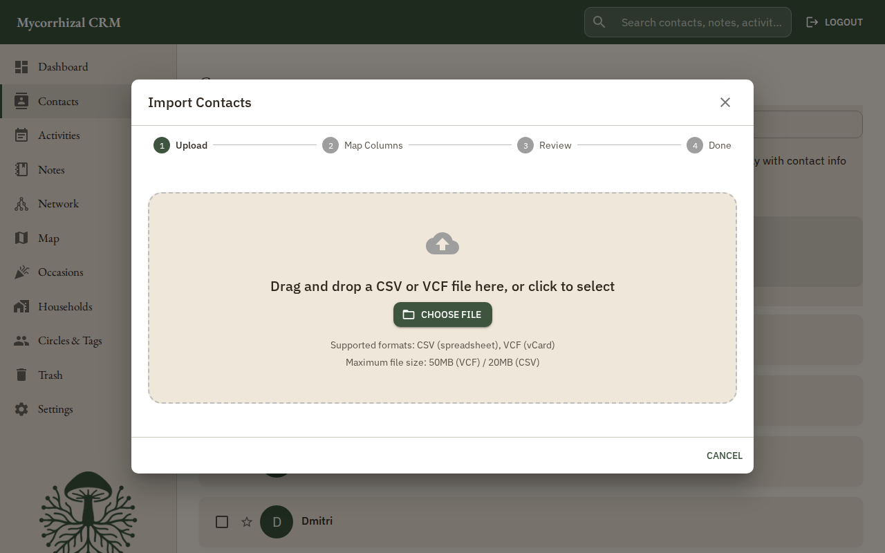

# Importing contacts

Import adds many contacts at once from a file or from another app. Nothing changes until you have reviewed the result.

## Import a CSV or vCard file

1. Go to **Contacts** and choose **Import**.
2. In **Upload**, drag a file in or choose **Choose file**. CSV (a spreadsheet export) and VCF (vCard, the standard contact file) are supported. The largest files accepted are 20 MB for CSV and 50 MB for VCF.
3. For a CSV, **Map Columns** lets you say which column holds the name, email, phone and so on.
4. **Review** shows what will be created and anything that looks like a duplicate or could not be read. Check it before you continue.
5. **Done** confirms what was imported.

## Import from Meerkat or Monica

If you are moving from Meerkat or Monica, the import assistants read your data directly and report every field that could not be carried over, so nothing is lost silently. Running the same import again does not create duplicates. What each source becomes here, and what it cannot carry, is described in the
[source import mapping reference](https://github.com/DrewBrunning/mycorrhizal-crm/tree/main/docs/import).

## Keep a copy of your data

Your data is always exportable. See [Settings](settings.html#account-bundle-export) for the account bundle, which is the way to move everything to another Mycorrhizal instance.
