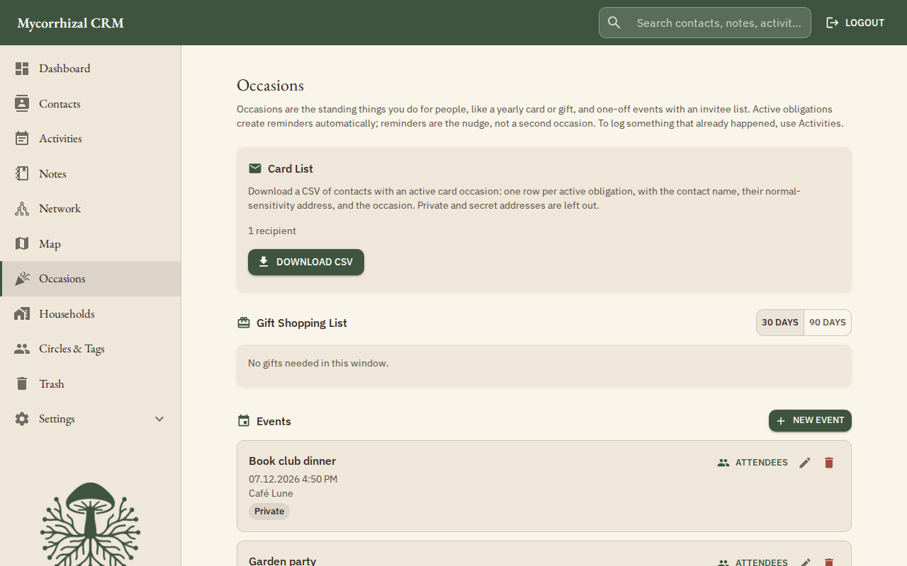

# Occasions and reminders

**Occasions** are the standing things you do for people, like a yearly card or a gift, and one-off events with an invitee list. They are for what you plan to do; to record something that already happened, use [Activities](activities-and-notes.html).

## What is on the page

- **Card List** downloads a CSV of the contacts you send cards to: one row per active card occasion, with the contact's name and address. Private and secret addresses are left out.
- **Gift Shopping List** shows the gifts you need in the next 30 or 90 days.
- **Events** lists one-off events. Choose **New event** to add one, and **Attendees** to choose who is invited.

## Reminders

Active occasions create reminders for you automatically. A reminder is the nudge, not a second occasion.

Reminders reach you by email, ntfy, Gotify or browser push. Set your channels up in [Notifications](notifications.html), and test each one before you rely on it.

## Stay in touch

On a contact's page, **Stay in touch** sets how often you want to be in touch with them. The status badge next to their name and the **Cadence & follow-up** tab show how you are doing against it.
