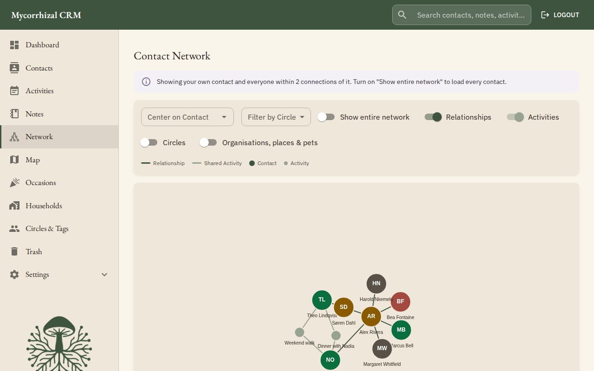

# Relationships and the network

Relationships record how two contacts are connected: parent and child, partners, colleagues, friends. They let you see your own network, not just a list of names.

## Add a relationship

1. Open a contact and choose the **People** tab, where their relationships are listed.
2. Choose **Add Relationship**.
3. Choose how to add it: **Link to existing contact** (search for the person) or **Enter details manually** (for someone who is not a contact).
4. Pick the **Relationship Type** and save.

A relationship describes the contact you are on relative to the other person: "parent of" from A to B means A is B's parent. The other direction is worked out for you, so you only record it once.

## See the whole network

Open **Network** in the sidebar.

- By default it shows your own contact and everyone within two connections of it. Turn on **Show entire network** to load every contact.
- **Center on Contact** re-centres the graph on someone else, and **Filter by Circle** limits it to one group.
- The **Relationships**, **Activities**, **Circles** and **Organisations, places & pets** switches choose which kinds of connection are drawn. Contacts are the coloured circles; a small grey circle is an activity that several contacts shared.

## Households

**Households** groups the people and pets who share a home. Households power shared-address suggestions and a combined card and gift list. Choose **Suggest Households** to see contacts who share an address but are not yet in a household together; nothing is created until you accept a suggestion.

## Organisations, places and pets

Organisations, places and pets (for example an employer, a favourite café or a dog) are their own kind of record, linked to contacts from a contact's **Organisations, places & pets** tab. A value that comes from one of them is shown as "from <name>" and is never edited as the contact's own.
